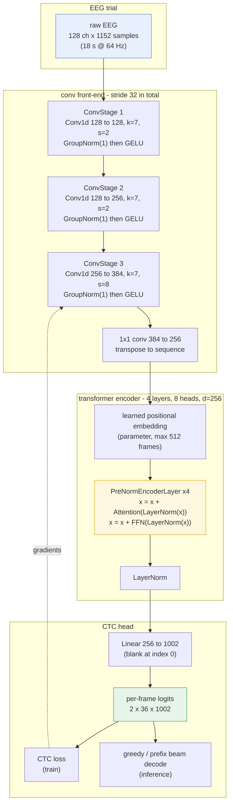

# bci-eeg-to-text

[](https://codespaces.new/fufurobot/bci-eeg-to-text)
[](https://mybinder.org/v2/gh/fufurobot/bci-eeg-to-text/main?filepath=notebooks)
[](https://github.com/fufurobot/bci-eeg-to-text/actions/workflows/ci.yml)

| | |
| --- | --- |
| **What** | EEG-to-text decoding with CTC, plus a multi-model benchmark harness |
| **Corpora** | ChineseEEG (ds004952), Chisco (ds005170) |
| **Entrypoints** | `bci dataset`, `bci experiment`, `bci benchmark`, `bci split`, `bci train` |
| **Status** | pipeline verified end to end; **accuracy not yet established** ([Status](#status)) |

Training an EEG-to-text decoder with **CTC loss** over EEG-text datasets.

The architecture is deliberately dataset-agnostic: a dataset is only a source of
`(EEG segment, text)` pairs, and the tokenizer, model, CTC loss, decoder and
metrics are identical regardless of where those pairs came from. Two corpora are
wired up:

| dataset | task | alignment | subjects | usable runs |
| --- | --- | --- | --- | --- |
| [ds004952](https://doi.org/10.18112/openneuro.ds004952.v1.2.2) ChineseEEG | silent reading | **stimulus markers** (`ROWS`/`ROWE`) | 10 (5F/5M) | 221 |
| [ds005170](https://doi.org/10.18112/openneuro.ds005170.v1.1.2) Chisco | imagined speech | recovered from reward pulses | 4 (2F/2M) | 168 |

Both are 128-channel EEG. `--dataset merged` trains on both at once.

## Try it without installing anything

| | what you get |
| --- | --- |
| [**Codespaces**](https://codespaces.new/fufurobot/bci-eeg-to-text) | full environment, `uv`, tests, CLI |
| [**Binder**](https://mybinder.org/v2/gh/fufurobot/bci-eeg-to-text/main?filepath=notebooks) | a notebook server, no sign-in |

Both build a **CPU-only** environment (~1.2 GB). The default local install uses
CUDA wheels, which are 5.7 GB and unusable without a GPU, so a hosted image
would otherwise be mostly dead weight; `.devcontainer/setup.sh` and
`binder/Dockerfile` install torch from the PyTorch CPU index instead.

In Codespaces:

```bash
uv run pytest -q -m "not realdata"   # 561 tests, no dataset needed
uv run bci --help                    # list every entrypoint
```

The EEG corpora are **not** included — they are 419 GB across two OpenNeuro
datasets — so the dataset-backed tests skip themselves. To use real data, fetch
it with DataLad and point the tools at it:

```bash
export EEG_TEXT_BCI_DATA_ROOT=/path/to/bci-eeg
uv run bci dataset prepare chineseeeg --out splits
```

See [Getting the data](#getting-the-data) for the full DataLad workflow.

## Alignment is the hard part, and it differs per dataset

**ChineseEEG (ds004952)** ships real triggers, so the pairing is *read*:

```
start = ROWS_k.sample          stop = next ROWE sample
text  = k-th data row of segmented_Chinense_novel_run_N.xlsx
```

A row's duration equals its highlighted character count times 0.35 s, which makes
the mapping checkable. Two non-obvious facts, both verified:

- **Chapter-banner rows must be kept.** They are rendered on screen and occupy a
  real interval. Keeping them gives 383 rows for 383 intervals with a
  duration/length correlation of +0.895; dropping them collapses it to +0.003.
- **Matching counts is not sufficient.** `ses-LittlePrince run-01` has an extra
  `ROWE` and an orphaned leading `ROWE`, so its durations are *anti*-correlated
  with text length (-0.135 against ~+0.88 for healthy runs). The loader therefore
  also requires correlation ≥ 0.5, which rejects exactly those 8 runs.

126 of 168 `.vhdr` headers also contain an upstream typo (`GranettDream` for
`GarnettDream`). They are repaired through a scratch mirror, since the dataset is
read-only.

**Chisco (ds005170)** is output-only: one uniform reward pulse per trial and *no*
stimulus-onset markers, so alignment is *recovered* — run `run-NNN` pairs with
`split_data_N.xlsx`, and the i-th pulse with the i-th sentence
([issue #1](https://github.com/fufurobot/bci-eeg-to-text/issues/1)). Verified:
150 pulses = 150 sentences for `sub-01_ses-02_run-010`.

Because a wrong pairing trains on mislabelled data and looks like a modelling
failure rather than a bug, **every loader validates and raises** instead of
truncating or padding to fit.

## Splits are participant-level and sex-balanced

Splitting by run leaks speaker identity and inflates scores, so the default is by
**subject**, with sex balanced across parts:

```bash
uv run bci-eeg-to-text split --dataset chisco       # 1:1  -> 2 train, 2 test (1F/1M each)
uv run bci-eeg-to-text split --dataset chineseeeg   # 3:1:1 -> 6/2/2 (3F+3M, 1F+1M, 1F+1M)
uv run bci-eeg-to-text split --dataset merged       # 14 subjects, namespaced ids
```

Run-level splitting is available for within-participant experiments but must be
requested explicitly, prints a WARNING, and is recorded in the output JSON:

```bash
uv run bci-eeg-to-text split --dataset chisco --level run
```

### Splits are symlinks, not copies

The split is materialised as a **tree of relative symlinks**, so you can see
which recordings belong to which part with `ls` instead of decoding a manifest:

```
splits/train/sub-04 -> ../../bci-eeg/ds005170/sub-04
splits/test/sub-01  -> ../../bci-eeg/ds005170/sub-01
```

Copying is not an option here — the corpora are 419 GB against ~15 GB free — and
a JSON manifest alone is opaque. Symlinks cost no space (16 KB for a merged
14-subject split, 620 KB at run level) and the targets are always **relative**,
so the tree still resolves after the dataset and split move together.

A `split.json` manifest is written alongside the tree for tooling.

### Leakage is a matrix, and it is never silent

Disjoint recordings are not enough. A split can leak along four independent
axes, and a good-looking score can come from any of them:

| axis | modes |
| --- | --- |
| **subject** | `none`, `one_subject`, `cross_subject` (**default**) |
| **text** | `none`, `row` (**default**), `paragraph`, `article` |
| **sex** | balanced — any `|F-M| > 0` inside a part is flagged |
| **run** | no recording may appear in two parts |

```bash
uv run bci-eeg-to-text split --dataset chineseeeg --leakage article
uv run bci-eeg-to-text split --dataset chineseeeg --subject-mode one_subject
```

The full matrix is printed **unconditionally**, because silence is the danger
here: "no output" is indistinguishable from "no leakage".

```
leakage matrix:
  subject=cross_subject: ok
  text=paragraph: ok
  sex=balanced: ok
  run=disjoint: ok
  no enforced axis leaks
```

An unenforced axis is marked `!` and the report states what is left unchecked:

```
! subject=none: NOT ENFORCED (upper bound)
! text=none: NOT ENFORCED (upper bound)
  unenforced: subject, text -- anything on these axes is leaked, results are an upper bound
```

A violated axis names exactly what leaks, with counts:

```
  sex=balanced: 2 violation(s)
      - 'valid' sex imbalance |F-M|=1 (F=1, M=0)
      - 'test' sex imbalance |F-M|=1 (F=0, M=1)
```

**Sex imbalance counts as leakage** because a part made up entirely of one sex
lets a model exploit sex-linked signal structure. Subjects with no recorded sex
are reported rather than assumed balanced.

**`one_subject`** picks one participant at random (seeded) and splits its runs
across train/valid/test, deliberately ignoring sex balance since with one subject
there is nothing to balance. Paragraph and article modes restrict the pick to
ChineseEEG — the only corpus shipping source documents — so the constraint is
meaningful rather than vacuous.

### Text leakage modes

This makes `paragraph` and `article` possible: rows are **verbatim substrings of
the source novels**, so each row's position is found by string search and its
paragraph and chapter follow from that offset. Measured on the real corpus,
**99.7% of rows (12,075 of 12,115)** resolve to both; the 40 that do not fall back
to row identity and so can never match a stricter check by accident. The command
prints this coverage, so weak structure is visible rather than assumed.

Groups are indivisible: rows of one paragraph travel together, because splitting
them would put half a paragraph in train and half in test — exactly the leak the
stricter modes exist to prevent.

### The split tree is readable

Recordings are symlinked (they are gigabytes) while the small text that says
what was read is **copied** beside them (it is kilobytes):

```
splits/train/sub-04         -> symlink: the recordings, 0 bytes
splits/train/sub-04.text/   -> copied participants.tsv, textmaps.json, 260 KB
```

So `ls` shows the EEG-to-text pairing directly instead of leaving you to decode
a manifest. `--no-text-copy` disables it.

### Data location is configuration

| setting | env | default | meaning |
| --- | --- | --- | --- |
| `--data-root` | `EEG_TEXT_BCI_DATA_ROOT` | `eeg-text-bci-data` | directory containing the corpora |
| `--data-subdir` | `EEG_TEXT_BCI_DATA_SUBDIR` | `bci-eeg` | corpus subdirectory |
| `--data-writable` | `EEG_TEXT_BCI_DATA_WRITABLE` | `false` | may splits be written inside the root? |

`--data-subdir` exists because the corpus directory name is not ours to assume;
it was previously hard-coded. `--data-writable` defaults to **false** because the
corpora are normally a read-only mount: splits then go to the current directory
and nothing under the dataset root is touched. If you set it on a read-only
mount the error names the flag to drop rather than raising a bare `OSError`.

The two datasets both use bare `sub-NN` ids, so merged mode namespaces them
(`chisco:sub-01`, `chineseeeg:sub-04`); without that they would collide.

## Getting the data

Both corpora are OpenNeuro datasets published as **DataLad / git-annex**
repositories. Git holds only the metadata (a few MB); the recordings live in
annex and are fetched on demand. The correct way to obtain them is DataLad:

```bash
mkdir -p ~/bci-data && cd ~/bci-data

# 1. Clone the metadata. This is small and fast.
datalad clone https://github.com/OpenNeuroDatasets/ds004952.git
datalad clone https://github.com/OpenNeuroDatasets/ds005170.git

# 2. Fetch only what you need, from INSIDE the cloned dataset.
cd ds004952
datalad get derivatives/preproc/filtered_0.5_80/sub-04    # one participant
cd ../ds005170
datalad get -n .                                          # metadata only

# 3. Point the tooling at the result.
export EEG_TEXT_BCI_DATA_ROOT=$HOME/bci-data
export EEG_TEXT_BCI_DATA_SUBDIR=.
bci dataset list
```

Fetching a whole corpus is ~419 GB and is not needed to start: the smoke
benchmark uses **ten runs from a single participant**, so `datalad get` on one
subject directory is enough to produce a number.

```bash
bci benchmark eeg2text --model conv-bert --dataset chineseeeg --smoke
```

### Two requirements that fail quietly

**`datalad get` only works from inside the cloned dataset.** Run it from the
dataset root (or pass `-d <dataset>`), not from a parent directory and not on
paths belonging to a different clone. Given a path outside the dataset it does
not raise — it reports `"no dataset annex, content already present"` and leaves
the file at its 220-byte pointer.

**`git-annex` must be installed, and DataLad does not require it.** Retrofitting
a plain `git clone` with `datalad` gives a repository that has `.datalad/` but
no `.git/annex/`. Every `datalad get` then exits **0** with no output and
fetches nothing. Install the backend first:

| system | command |
| --- | --- |
| Debian/Ubuntu | `sudo apt install git-annex datalad` |
| Arch | `sudo pacman -S git-annex datalad` |
| no root | `uv tool install datalad`, then obtain `git-annex` separately |

Verify before trusting a download:

```bash
git annex version                       # must print a version
cd ds004952 && datalad -f json get <path>   # status should be "ok", not "notneeded"
```

### An annex pointer is not missing data

An unfetched file is a symlink into `.git/annex/objects`. A dataset can be
cloned with 100% of its metadata and 0% of its bytes. The tooling reports such
runs as unfetched rather than silently scoring zeros — and because a real
`.vhdr` header can sit beside a stubbed `.eeg` payload, both files are checked:
that combination opens without error and only later reports zero samples.

### What not to do

- **Don't `rsync`/`cp` a mounted copy.** It reads `.git/annex/objects`, which
  duplicates content the working tree already exposes, and a cheap USB driver
  drops off the bus under sustained load mid-copy.
- **Don't hand-roll HTTP fetches of annex objects.** It is possible (OpenNeuro's
  S3 bucket keys objects by dataset-relative path), but nothing verifies a hash,
  throughput collapses under concurrency, and a truncated transfer is
  indistinguishable from a complete one unless you compare sizes yourself.

## Running experiments: one entrypoint per concern

Datasets and experiments are addressed **by name**, so adding a corpus or a
future EEG task does not mean new flags on every command:

```bash
bci dataset list                        # what corpora exist
bci dataset info chineseeeg             # rates, subjects, text granularity
bci dataset prepare chineseeeg --out splits   # delegates to `split`

bci experiment list                     # what can be run
bci experiment run conv-transformer --dataset chineseeeg --smoke
```

`bci experiment run` validates placement **before** any work starts:
`--training-mode {cpu,gpu,ssh}` and `--strategy {dataparallel,fsdp}`.
Asking for `gpu` without a CUDA device raises instead of quietly running on CPU,
which here is roughly two orders of magnitude slower and would look like a
modelling failure rather than a configuration mistake.

## Benchmark

Five experiments are scored through one harness, so no two rows can be measured
with different metrics:

| row | model | trains here? |
| --- | --- | --- |
| `conv-bert` | conv front-end + BERT encoder + CTC | yes (in process) |
| `conv-transformer` | conv front-end + transformer encoder + CTC, one forward pass | yes (in process) |
| `echo` | [ECHO](https://huggingface.co/wythedee/ECHO): FAST encoder, projection, Whisper decoder | needs external weights |
| `thought2text` | [Thought2Text](https://github.com/jingweiluo/Thought2Text): ChannelNet + LLM | needs base LLM + LoRA |
| `neurolm` | NeuroLM NeuralTransformerVQ + adapter | needs external weights |

```bash
# smoke: 10 runs holding 5 texts from ONE subject, 5-fold 3-1-1
bci benchmark eeg2text --model conv-bert --dataset chineseeeg --smoke

# several corpora in one pass
bci benchmark eeg2text --model all --dataset chineseeeg --dataset chisco
```

`--smoke` selects 10 runs containing five distinct texts from a single subject,
two runs per text, then cross-validates 3-1-1 (6 train / 2 valid / 2 test) so
every run is tested exactly once. The selector **raises** when a corpus cannot
supply that sample rather than quietly returning fewer runs — a shrunken sample
silently compares numbers computed on different data.

A row that cannot run is reported as a **skip with a reason**, never as a zero.
A fabricated baseline score is worse than an acknowledged gap.

### What a smoke run does and does not tell you

A smoke run proves the pipeline end to end — index, stream, train, decode,
score, report — and nothing about accuracy. Measured on the cluster machine:

```
conv-bert        cer=1.000   exact=0.000   n=5139   451s
thermal: 10 samples, peak 51C
```

`CER 1.000` means the decoder emitted nothing. The pipeline was verified healthy
separately (CTC loss fell 87.4 → 8.2 over 30 steps, with 72 frames for at most
12 target characters), so this is **under-training, not a broken model**: a fold
trains on ~6 runs for a few minutes, and CTC needs far more than that before
greedy decoding produces its first character.

## Training safely

The development machine's fan is broken and cooling is external, so temperature
is a safety constraint rather than a metric:

```bash
bci benchmark eeg2text --model conv-bert --dataset chineseeeg --smoke \
  --max-temp 80 --max-cpu-temp 88 --thermal-interval 60
```

| flag | default | meaning |
| --- | --- | --- |
| `--max-temp` | 80 | GPU ceiling (hard limit) |
| `--max-cpu-temp` | 88 | CPU ceiling, looser because the external cooling cannot hold it lower |
| `--thermal-interval` | 10 | seconds between samples while running |

Sensors are read from `/sys/class/thermal` and `nvidia-smi`. A run **refuses to
start** when a sensor is already above its limit, and **aborts** at the first
breach rather than logging a warning while continuing to heat the CPU. An
unreadable machine is treated as *unknown*, never as cool.

## Status

What is proven, and how:

| area | state |
| --- | --- |
| CTC pipeline (tokenizer, model, loss, decoder, metrics) | tested; loss falls 87.4 → 8.2 over 30 steps |
| Streaming reads from the corpus | tested; no data is copied |
| Splits and the leakage matrix | tested; runs on real data |
| Benchmark harness + smoke sampling | tested; produced a real result on real data |
| Thermal guard | tested; enforced live (refused to start at 84 °C, then ran at 51 °C peak) |
| Training modes / FSDP / multi-hop SSH | tested; **not** exercised on a real cluster |
| HuggingFace release folder | tested round-trip; **not** yet published to the Hub |
| Accuracy on either corpus | **not established** — see below |

### Not established yet

- **No meaningful accuracy number.** Every run so far used one participant and
  minutes of training, which is enough to prove the plumbing and not enough for
  CTC to emit text. A real result needs the full corpus and hours, not minutes.
- **Only sub-04 of ChineseEEG (ds004952) has been trainable.** Other
  participants' recordings exist as git-annex pointers; resolving them needs
  `git-annex` installed and `datalad get`, which this environment could not
  complete. ds005170 (Chisco) has not been trained on at all.
- **`bci experiment run` validates and plans; it does not yet launch a
  distributed job.** It resolves the topology, probes SSH reachability, chooses
  the strategy and prints the exact command it would run. `--smoke` hands off to
  the benchmark runner, which does train.
- **Baselines are not measured.** ECHO's weights load and its shape is reported
  (Whisper decoder, vocab 51,865, d_model 384), but the weights were published
  without the `FAST`/`EEG2Text` code, so it cannot be instantiated. Thought2Text
  needs a base LLM plus stage-2 LoRA adapters. Both report a skip with that
  reason rather than a score.

Recording these limits is deliberate: a README that implies proven accuracy
invites someone to cite a number that does not exist.

## Dataset notes

- The 46 git-annex pointers in ds005170 are **deliberate** — the drive is too
  small to hold everything — so they are skipped quietly rather than reported as
  errors, and ds005170 genuinely has 4 usable subjects
  ([issue #2](https://github.com/fufurobot/bci-eeg-to-text/issues/2)).
- Runs carry a **global** run index, so `run-08` and `run-010` both live in
  `ses-02`; mapping keys on the run number, never session order.
- No `task-read` EDF exists in ds005170 despite the derivatives listing one.
- The ds005170 pulse is assumed to mark trial **onset**; see
  `ChiscoSource.pre_samples`.
## Pipeline

```
EDF run ──► reward pulses ──┐
                            ├──► aligned trials ──► CTC model ──► text
split_data_N.xlsx ──────────┘
```

| Module | Responsibility |
| --- | --- |
| `dataconfig.py` | dataset location resolution, symlinked split materialisation |
| `splittree.py` | reading split trees; leakage detection |
| `leakage.py` | leakage matrix: subject, text, sex and run axes |
| `textstructure.py` | recovering row/paragraph/article identity from source novels |
| `splitdata.py` | turning a split tree into training datasets |
| `streaming.py` | **index + random-access reads straight from the corpus**; no copies |
| `backbones.py` | interchangeable encoders (`scratch`, `conv-transformer`, `bert-ctc`, NeuroLM modes) |
| `conv_transformer.py` | conv front-end + pre-norm transformer encoder |
| `hf_model.py` | HuggingFace-native model, config, and the any-folder backbone loader |
| `hf_tokenizer.py` | HuggingFace tokenizer wrapping the character vocabulary |
| `hf_processor.py` | HuggingFace processor for EEG crop/pad plus labels |
| `hf_release.py` | builds a self-contained, publishable model folder |
| `accelerated.py` | `accelerate` training loop, scheduler, CTC eval |
| `distributed.py` | training modes (cpu/gpu/ssh) and strategies (dataparallel/fsdp) |
| `thermal.py` | temperature monitoring and enforcement |
| `benchmark.py` | adapters and scoring shared by every experiment |
| `benchmark_runner.py` | the in-process experiments and the fold runner |
| `benchmark_cli.py` | the `benchmark eeg2text` command |
| `smoke.py` | smoke sampling and 3-1-1 fold construction |
| `registry.py` | dataset and experiment registries |
| `entrypoints.py` | the `dataset` and `experiment` commands |
| `neurolm.py` | loading NeuroLM components and checkpoints |
| `neurolm_native.py` | native NeuroLM tokenizer (patch embed, transformer, VQ) |
| `sources.py` | `DatasetSource` protocol, registry, `participants.tsv` parsing |
| `chineseeeg.py` | ds004952 reader: events, row intervals, novel text, header repair |
| `chisco.py` | ds005170 reader: reward-pulse recovery |
| `splits.py` | participant-level, sex-balanced train/valid/test partitioning |
| `eeg.py` | EDF reading, pulse detection, segment alignment |
| `textdata.py` | ds005170 stimulus sentences from `split_data_*.xlsx` |
| `tokenizer.py` | character-level CTC vocabulary |
| `data.py` | trial caching and batching over either source |
| `model.py` | strided convolutional encoder + CTC head |
| `decode.py` | greedy / prefix beam search, CER, sentence accuracy |
| `train.py` | training and evaluation loops |
| `cli.py` | `prepare`, `split`, `inspect`, `train`, `benchmark`, `dataset`, `experiment`, `evaluate` |

## Training modes

The encoder is interchangeable; the CTC loss, decoder and metrics are shared.
`--mode` selects one:

| mode | encoder | typical use |
| --- | --- | --- |
| `scratch` | strided conv encoder | baseline, no downloads |
| `conv-transformer` | conv front-end + transformer encoder | strongest in-process row; see below |
| `bert-ctc` | pretrained HuggingFace BERT + CTC head | reuse language representations |
| `neurolm-sft` | full [NeuroLM](https://github.com/935963004/NeuroLM) model | supervised fine-tuning |
| `neurolm-adapter` | HuggingFace causal LM + adapter | bridge a NeuroProcessor to an LM |

Training reads a **split tree**, so the split actually governs what is trained
on. Recordings are extracted on demand into `<out>/cache/<part>`, keyed by the
resolved source path, so there is no separate preparation step to keep in sync.

```bash
# 1. define the split (subject level, sex balanced) as a symlink tree
uv run bci-eeg-to-text split --dataset merged --link

# 2. train: --split is all the trainer needs
uv run bci-eeg-to-text train --split splits --out runs/scratch --mode scratch

# pretrained BERT with the backbone frozen: only the adapter and head train
uv run bci-eeg-to-text train --split splits --out runs/bert \
  --mode bert-ctc --pretrained bert-base-chinese --freeze-backbone

# fine-tune the whole NeuroLM model
uv run bci-eeg-to-text train --split splits --out runs/neurolm-sft \
  --mode neurolm-sft --lm-name gpt2

# causal LM + adapter, training our own NeuroProcessor from scratch
uv run bci-eeg-to-text train --split splits --out runs/adapter \
  --mode neurolm-adapter --lm-name gpt2 --processor scratch

# same, but reusing a pretrained NeuroProcessor (NeuroLM's own recipe)
uv run bci-eeg-to-text train --split splits --out runs/adapter-pre \
  --mode neurolm-adapter --lm-name gpt2 --processor pretrained \
  --pretrained checkpoints/VQ.pt

# evaluate on the held-out part of the same split
uv run bci-eeg-to-text evaluate --split splits --checkpoint runs/bert/last.pt
```

**Subject-level and run-level splits behave identically here.** The trainer
consumes whichever tree it is given; the difference is only what the links point
at. That is the payoff of materialising splits as links rather than as a
manifest that training would have to interpret.

Every load calls `check_no_leakage()`, which fails if a recording resolves into
two parts. A trial shared between train and test inflates scores while looking
like a good model, so it is an error rather than a warning. `--cache` still
exists for quick experiments but carries no split information, so validation
falls back to a holdout from the training data and says so.

### The conv-transformer encoder

`conv-transformer` is the architecture this project trains from scratch, and the
one drawn here. A convolutional front-end compresses the raw trial, then pre-norm transformer
blocks attend over the whole trial at once, and a linear head emits one
character distribution per frame. CTC does the alignment, so the whole sentence
comes out of a **single forward pass** — there is no autoregressive loop.



Shapes as actually produced by the code (batch of 2, verified against the
implementation, not sketched from the config):

| stage | tensor |
| --- | --- |
| input | `(2, 128, 1152)` |
| after conv stack | `(2, 384, 36)` |
| to model width | `(2, 36, 256)` |
| head logits | `(2, 36, 1002)` |

Three details that matter more than they look:

- **Each stage is residual.** When the stride is 1 and the width is unchanged the
  shortcut is the identity; otherwise it is a strided convolution. Average
  pooling was rejected because it computes `floor(n/s)` while the main conv
  computes `floor((n-1)/s)+1` — the shorter path silently dropped a frame.
- **GroupNorm in the conv stages, LayerNorm in the transformer.** One channel
  per group normalises across the whole channel axis, which is what a conv
  feature map wants; residual blocks use pre-norm LayerNorm.
- **Attention is bidirectional.** Padding is excluded with a key mask, but
  otherwise every frame sees every other frame — that is what lets a single
  forward pass commit to a whole sentence.

### Why these work the way they do

**EEG has no token ids.** For `bert-ctc` the signal is projected into BERT's
hidden space and passed as `inputs_embeds`, so the entire pretrained transformer
stays usable while only a small input adapter and the CTC head need training.
`--freeze-backbone` then trains a small fraction of parameters (9.8% in a smoke
test: 38,752 frozen of 111,649).

**BERT has a fixed context length.** Long trials exceed `max_position_embeddings`,
so the convolutional front-end pools adaptively to fit, and the CTC length
mapping mirrors that same arithmetic. Verified exact at 800/1135/8000/64000
samples, all within the 512-frame limit.

**NeuroLM's NeuroProcessor is its vector-quantized EEG tokenizer.** In
`neurolm-adapter` the adapter is the analogue of NeuroLM's own
`encode_transform_layer`: a small learned map from processor features into the
language model's embedding space. `--processor scratch` trains that processor
from scratch instead of reusing the released weights.

Training prints the parameter budget so the effect of freezing is visible:

```
device=cpu mode=bert-ctc trials=559 channels=128 classes=1057
parameters: total=111,649 trainable=72,897 (65.3%) frozen=38,752
```

Checkpoints record the mode and backbone options, so `evaluate` rebuilds the
same architecture rather than guessing.

## Setup

Requires Python 3.13 and [uv](https://docs.astral.sh/uv/).

```bash
uv sync
cp .env.example .env && chmod 600 .env   # then fill in credentials
```

`.env` is git-ignored and must never be committed. `.env.example` is the
credential-free template.

## Usage

The common path, start to finish:

```bash
# 1. stage the data (see "Getting the data"), then point the tools at it
export EEG_TEXT_BCI_DATA_ROOT=$HOME/bci-data
export EEG_TEXT_BCI_DATA_SUBDIR=.

# 2. see who is available and how the split is formed
bci dataset list
bci split --dataset merged

# 3. materialise the split as a symlink tree (nothing is copied)
bci dataset prepare chineseeeg --out splits --leakage paragraph

# 4. prove the pipeline on a tiny slice
bci benchmark eeg2text --model conv-bert --dataset chineseeeg --smoke

# 5. inspect the launch plan a distributed run would use (validates placement
#    and prints the command; it does not start training yet)
bci experiment run conv-transformer --dataset chineseeeg \
  --training-mode ssh --strategy fsdp --hosts jump:22|worker:4

# 6. inspect one run when alignment looks wrong
bci inspect eeg-text-bci-data/bci-eeg/ds005170/sub-01/ses-02/eeg/\
sub-01_ses-02_task-imagine_run-010_eeg.edf
```

The lower-level commands remain available. `train` reads a **split tree**, so the
split governs what is trained on, and `--cache` still exists for quick
experiments but carries no split information — validation then falls back to a
holdout and says so.

### Published model folders

A trained model can be written as a standard HuggingFace folder and loaded with
the stock entry points:

```python
from transformers import AutoModel, AutoTokenizer, AutoProcessor

model = AutoModel.from_pretrained("release/", trust_remote_code=True)
```

The folder is **self-contained**: `hf_release.py` vendors the architecture,
config, tokenizer and processor beside the weights, so loading it does not
require this package to be installed. `load_any_backbone` accepts any folder
`AutoModel` can load with `trust_remote_code=True`; non-EEG architectures are
adapted (channels projected to the model's width, time axis pooled to
`max_position_embeddings`) rather than rejected.

## Tests

```bash
uv run pytest -q -m "not realdata"   # unit tests, no dataset needed
uv run pytest -q                     # includes dataset-backed tests
```

Real-data tests are marked `realdata` and skip automatically when the dataset is
not mounted. CI runs with `HF_HUB_OFFLINE=1`; the backbone tests build tiny
checkpoints locally rather than downloading them, and CI publishes coverage
(terminal, XML and HTML) plus JUnit results as artifacts on every run.

## Design notes

**Temporal downsampling is not optional.** Trials are tens of thousands of
samples while targets are 6–15 characters, and CTC requires
`input_length >= target_length`. The encoder strides the time axis by 128×.

**CTC length bookkeeping is exact.** `input_lengths_to_output` replays the
encoder's own layer arithmetic rather than approximating. Over-reporting lengths
makes CTC consume padding frames as if they were signal — a bug that degrades
results quietly instead of raising.

**Metrics are text metrics.** Character error rate and exact-sentence accuracy
are the numbers that matter; a model can look plausible per character while
getting whole sentences wrong.

## Dataset

Read-only; not vendored here. `eeg-text-bci-data` is a symlink to the dataset
mount and is git-ignored.

- Chisco, Zhang et al. — [GitHub](https://github.com/zhangzihan-is-good/Chisco)
- DOI: [10.18112/openneuro.ds005170.v1.1.2](https://doi.org/10.18112/openneuro.ds005170.v1.1.2)
- License: CC0
